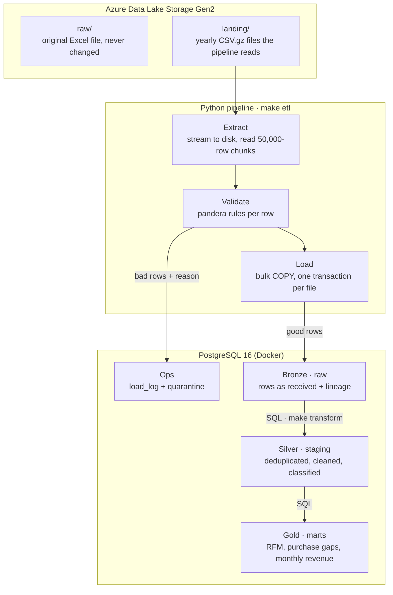
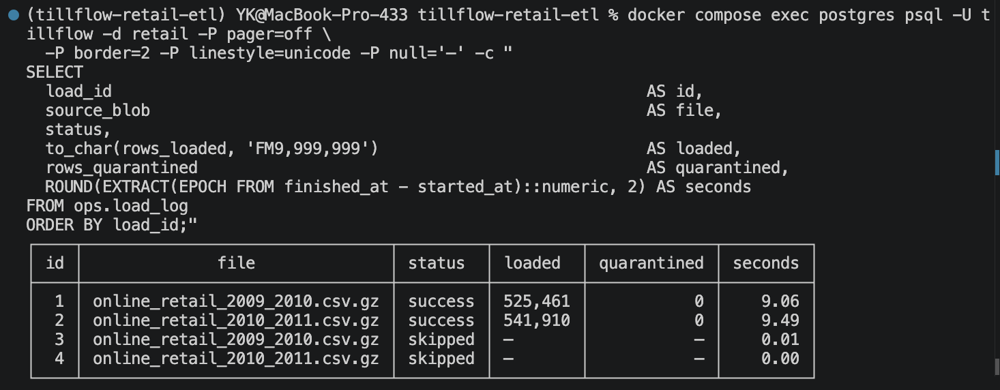
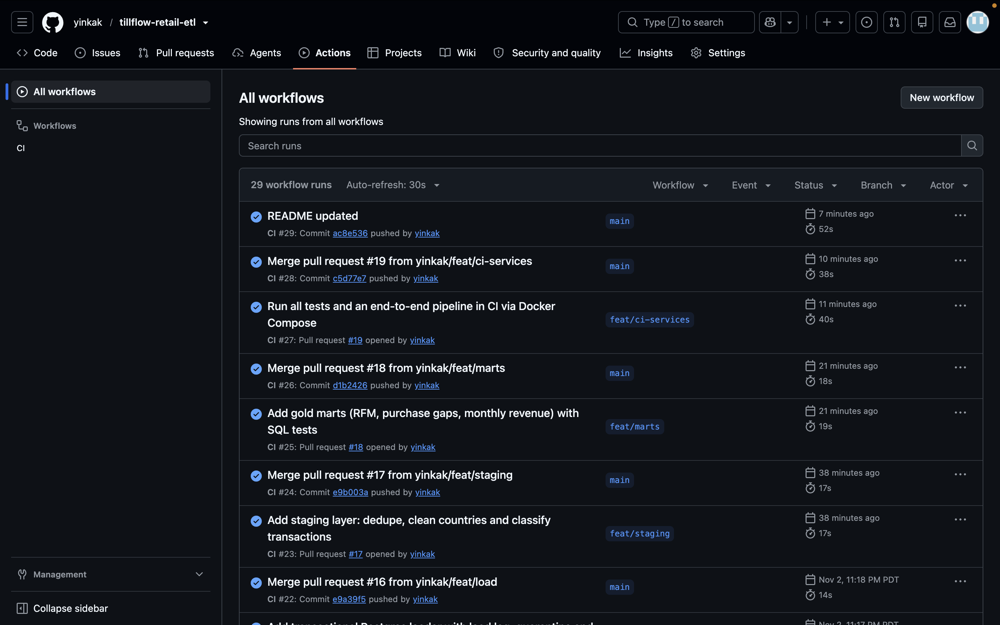

# TillFlow — Retail Data Pipeline (Azure Data Lake → PostgreSQL)


An end-to-end **ETL pipeline** that moves **1,067,371 real retail transactions** from an **Azure Data Lake** into **PostgreSQL**, validates every row, and builds business-ready tables with SQL: customer value scores, purchase habits and revenue trends.

It's built the way a production data team works: **idempotent reruns**, **transactional loads**, **identity-based cloud access (no stored keys)**, **29 automated tests**, and **CI that rebuilds the whole system from scratch on every pull request**.

---

## Results at a glance

| Metric | Result |
| --- | --- |
| Rows loaded from Azure Data Lake | **1,067,371** (2 files, 22 chunks of 50,000) |
| Full load time | **~20 seconds** |
| Rerun on unchanged files | **0.1 seconds**, zero duplicates (ETag-based skip) |
| Rows quarantined by validation | **0**: every unusual row was valid business data (see [Findings](#findings-from-the-data)) |
| Exact duplicates removed in silver | **34,335** |
| Revenue reconciliation, staging vs. marts | **$19,642,676.02**, matching to the cent |
| Customers scored (RFM) | **5,852** |
| Automated tests | **29** (unit + integration against real Postgres and Azure Storage emulator) |
| CI | Lint, all tests and an end-to-end pipeline run on every PR, about 40–50 s |

---

## Architecture



Database layers follow the **medallion pattern**: `raw` = bronze, `staging` = silver, `marts` = gold, with pipeline bookkeeping in `ops`.

---

## Quick start: no Azure account needed

**Requires:** [Docker Desktop](https://www.docker.com/products/docker-desktop/), [uv](https://docs.astral.sh/uv/) and `make`.

```bash
git clone https://github.com/yinkak/tillflow-retail-etl.git
cd tillflow-retail-etl
uv sync
make all
```

`make all` starts Postgres and **Azurite** (Microsoft's local Azure Storage emulator), creates the tables, uploads a 100-row sample, and runs the full pipeline through bronze, silver and gold. Then explore:

```bash
make psql
```
```sql
SELECT * FROM marts.monthly_revenue ORDER BY month;
SELECT * FROM marts.customer_rfm ORDER BY monetary DESC LIMIT 10;
SELECT * FROM ops.load_log;
```

<details>
<summary><b>Running against a real Azure Data Lake</b></summary>

1. `cp .env.example .env`, then set `STORAGE_MODE=azure` and `AZURE_STORAGE_ACCOUNT=<your account>`
2. `az login`. The pipeline authenticates with your Microsoft Entra ID identity; no keys are stored
3. Your account needs the *Storage Blob Data Contributor* role on the storage account
4. `make etl transform`

</details>

### All commands

| Command | Does |
| --- | --- |
| `make all` | Start services, create tables, load the sample, build every table |
| `make etl` | Extract → validate → load into Postgres |
| `make transform` | Build silver and gold tables with SQL |
| `make test` | All 29 tests (needs Docker); `make test-unit` for the fast ones |
| `make lint` / `make format` | Ruff checks / auto-fix |
| `make help` | List everything |

---

## How it works

**1. Land the data.** The source Excel file is converted once to gzipped CSVs ([`scripts/convert_xlsx.py`](scripts/convert_xlsx.py)) with every value kept as text, then uploaded to an Azure Data Lake Gen2 account: `raw/` keeps the untouched original, `landing/` holds pipeline-ready files.

**2. Extract** ([`extract.py`](src/tillflow_retail_etl/extract.py)). Lists landing files with their **ETags** (content fingerprints), streams each to disk, and reads it in 50,000-row chunks, so memory never holds a whole file. One setting switches between real Azure and the local emulator.

**3. Validate** ([`validate.py`](src/tillflow_retail_etl/validate.py)). A [pandera](https://pandera.readthedocs.io/) schema checks invoice format, non-zero integer quantities, parseable dates, customer ID format, and that negative prices appear only on accounting-adjustment invoices. Failing rows are quarantined **with the rule they broke and their original values**.

**4. Load** ([`load.py`](src/tillflow_retail_etl/load.py)). Valid rows are bulk-loaded with Postgres `COPY`. Each file loads in **one transaction**, and every run (success, skipped or failed) is recorded in `ops.load_log`.

**5. Transform** ([`sql/`](sql/)). Silver removes duplicates with `ROW_NUMBER()`, standardizes country names, and classifies every row (cancellation, adjustment, stock write-off, non-product, product sale). Gold builds three marts with **CTE chains and window functions** (`NTILE`, `LAG`, running `SUM() OVER`). All transforms run in one transaction.


*`ops.load_log` after the full load from Azure: one audited load per file.*

---

## Design decisions

| Decision | Why |
| --- | --- |
| **Profile before writing validation rules** | Rules written blind either miss real problems or reject valid data. Profiling all 1M rows first ([`scripts/profile_data.py`](scripts/profile_data.py)) grounded every rule in evidence |
| **Validation rejects broken data; staging classifies valid-but-different data** | Cancellations, stock write-offs and postage lines are real business events. Quarantining them would hide activity; flagging them lets each mart decide what to include |
| **One transaction per file** | A crash at chunk 7 of 11 leaves **no** partial data, and a rerun starts clean |
| **ETag-based load log** | Unchanged files are skipped; changed files (new ETag) are replaced, never duplicated |
| **Postgres `COPY` instead of row-by-row inserts** | The bulk-load path. The pipeline is I/O-bound (~25% CPU), so the next speed-up would be parallel file loads or running closer to the data, not faster Python |
| **Lineage on every row** (`source_blob`, `load_id`) | Any row traces back to the exact file and run that produced it |
| **`NUMERIC` for money** | Exact decimals. Floats drift when summing a million prices |
| **Identity-based access (Entra ID + RBAC)** | No storage keys exist anywhere in code, config or CI. Access is least-privilege, scoped to one storage account |
| **Same Docker Compose file locally and in CI** | "Works on my machine" and "works in CI" are the same claim |
| **Azurite emulator** | Tests, CI and reviewers run everything with no cloud account or cost |
| **Flag the partial final month** | The data ends Dec 9, 2011, and an unflagged December looks like a 58% crash |

---

## Findings from the data

- **Strong Q4 seasonality.** Revenue climbs every September–November, peaking at **$1.43M (Nov 2010)** and **$1.45M (Nov 2011)**, followed by a post-holiday slump each January–February.
- **Guests buy less.** Purchases without a customer ID are **23% of rows but only 13% of revenue** ($2.57M of $19.64M).
- **The most valuable customers are also the most active.** The top five by spend all score **555** (most recent, most frequent, highest spending). One customer placed **373 orders**.
- **Customers return about every 112 days** on average.
- **The data is structurally clean but semantically messy.** Zero rows failed validation, yet 34,335 were exact duplicates, 19,104 were cancellations, 3,393 were stock write-offs, and 5,981 were postage, fees or manual entries rather than products.

---

## Testing and CI

| Suite | Tests | Proves |
| --- | --- | --- |
| Validation | 16 | Valid-but-unusual rows pass; each broken-data rule fires; rows in = valid + quarantined |
| Extract (Azurite) | 2 | Only data files are listed; uneven chunk boundaries are read correctly |
| Load (Postgres) | 4 | Skip if unchanged, replace if changed, **full rollback on a mid-file crash**, quarantine with reason |
| SQL transforms | 6 | Hand-calculated answers for dedupe, classification and all three marts, plus revenue reconciliation; run inside a rolled-back transaction |
| Smoke | 1 | Package imports |

**On every pull request**, GitHub Actions installs from the lockfile, runs Ruff, starts Postgres and Azurite with `docker compose`, runs all 29 tests, then runs the pipeline end to end and verifies data reached bronze, silver and gold. `main` is protected, so nothing merges unless CI passes. Every commit also passes pre-commit hooks: Ruff, **gitleaks** secret scanning, YAML/TOML checks and a 1 MB file-size guard.



---

## Engineering notes

Real problems solved along the way:

- **Editable install silently ignored on macOS.** Python 3.12 skips `.pth` files flagged as hidden, and iCloud Desktop sync was setting that flag, so the package built but wouldn't import. Diagnosed with `ls -lO`; fixed by moving the project out of iCloud-synced storage.
- **"Azure CLI not found" from Python.** The CLI was installed as a shell *alias*, which subprocesses can't see. `DefaultAzureCredential` searches `PATH`, so I replaced the alias with a symlink in `~/.local/bin`.
- **Misleading "SubscriptionNotFound."** New Azure subscriptions must register each resource provider (`Microsoft.Storage`) before first use; Azure reports the missing registration as a missing subscription.
- **Region restrictions.** The student subscription only allows a few regions, so storage lives in West US. In production I'd keep data in a Canadian region for data residency.
- **Emulator behind the SDK.** The Azure SDK used a newer storage API version than Azurite supported; fixed with `--skipApiVersionCheck`, standard when local emulators lag cloud SDKs.
- **Port clash.** A container stuck in `Created` status revealed a local Postgres already holding port 5432; the project's database runs on 5433.


The full phase-by-phase story, including each phase's measurements and decisions, is in the **[build log](docs/BUILD_LOG.md)**.

---

## Project structure

```
tillflow-retail-etl/
├── .github/workflows/ci.yml   # lint, all tests, end-to-end run
├── docker-compose.yml         # Postgres 16 + Azurite
├── Makefile                   # make all / etl / transform / test ...
├── src/tillflow_retail_etl/
│   ├── config.py              # settings from env / .env
│   ├── storage.py             # Azure or Azurite connection (one place for auth)
│   ├── extract.py             # list, download, chunk
│   ├── validate.py            # pandera schema + quarantine split
│   ├── load.py                # COPY, load log, transactions
│   ├── transform.py           # runs the SQL layers
│   └── pipeline.py            # extract -> validate -> load
├── sql/
│   ├── ddl/                   # schemas and tables (idempotent)
│   ├── staging/               # silver: dedupe, clean, classify
│   └── marts/                 # gold: RFM, purchase gaps, monthly revenue
├── scripts/                   # convert_xlsx, profile_data, seed_azurite
├── tests/
│   ├── fixtures/              # 100-row real sample
│   ├── integration/           # extract, load, SQL transforms
│   └── test_validate.py       # validation rules
└── docs/img/                  # screenshots
```

---

## Tech stack

| Area | Tools |
| --- | --- |
| Cloud | Azure Data Lake Storage Gen2, Microsoft Entra ID (RBAC), Azure CLI, Cost Management |
| Pipeline | Python 3.12, pandas, pandera, psycopg 3 |
| Database | PostgreSQL 16, SQL (CTEs, window functions) |
| Infrastructure | Docker Compose, Azurite |
| Quality | pytest, Ruff, pre-commit, gitleaks |
| CI | GitHub Actions |
| Tooling | uv (lockfile), Make |

---

## What I'd do next

- **Orchestrate** scheduled runs (Azure Data Factory or a GitHub Actions cron)
- **Parallelize** file loads; the pipeline is I/O-bound
- **Rebuild the transforms in dbt** for lineage docs and built-in tests
- **Power BI dashboard** on the gold tables
- **Managed database** (Azure Database for PostgreSQL) in a Canadian region

---

## Dataset

[**Online Retail II**](https://archive.ics.uci.edu/dataset/502/online+retail+ii), UCI Machine Learning Repository: 1,067,371 transactions from a UK-based online retailer, December 2009 to December 2011. Licensed CC BY 4.0. The dataset is not committed to this repo; `.gitignore` and the pre-commit file-size guard keep it out.

---

## Author

**Yinka Kolawole** · Data Science, Simon Fraser University · [GitHub](https://github.com/yinkak)
