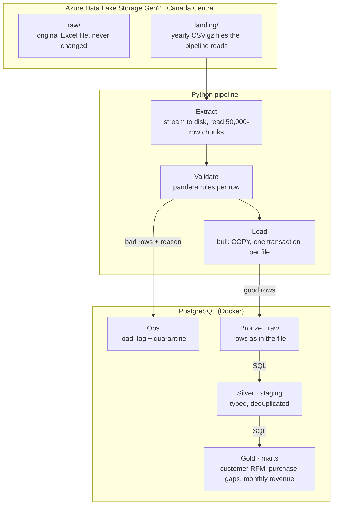

# TillFlow — Retail Data Pipeline (Azure Data Lake → PostgreSQL)

> **Status: in progress.** Project foundations are complete; the pipeline itself is being built in phases. See [Progress](#progress) for exactly what is done and what is next.

TillFlow is an end-to-end **ETL pipeline** that moves **1M+ real retail transactions** from an **Azure Data Lake** into **PostgreSQL**, validates every row, and turns the data into business-ready tables with SQL.

It is built the way a production data team would build it: reproducible environments, automated quality checks, secret scanning, login-based cloud access instead of stored keys, and a pull-request workflow for every change.

---

## Why this project

Most companies keep raw data in cloud storage that analysts can't use directly. Someone has to build a reliable pipeline that:

1. **Extracts** files from the data lake without running out of memory
2. **Validates** every row and sets bad rows aside *with a reason*, instead of silently dropping them
3. **Loads** clean data into a database safely, so re-running never creates duplicates
4. **Transforms** it into tables analysts can actually use (customer value, purchase habits, revenue trends)

TillFlow does all four on a real dataset and documents the engineering decisions behind each step.

---

## Architecture (target design)



The database layers follow the **medallion pattern**: `raw` = bronze, `staging` = silver, `marts` = gold.

---

## Progress

| Phase | What it covers | Status |
| --- | --- | --- |
| 0 · Accounts & safety | Azure subscription, cost budget alert, Azure CLI login, dataset downloaded | ✅ Done |
| 1 · Project scaffold | Repo, Python packaging, dependency locking, pre-commit quality gates | 🟡 In progress |
| 2 · Azure Data Lake | Resource group, ADLS Gen2 storage account, containers, role-based access | ⬜ Next |
| 3 · Extract | Chunked reads from the lake (real Azure or local emulator) | ⬜ Planned |
| 4 · Validate | pandera schema, quarantine with reasons | ⬜ Planned |
| 5 · Load | Bulk `COPY` into Postgres, idempotent reruns, load log | ⬜ Planned |
| 6 · SQL transforms | Silver + gold tables with CTEs and window functions | ⬜ Planned |
| 7 · Tests & CI | GitHub Actions with Postgres + Azurite service containers | ⬜ Planned |
| 8 · Publish | Measured results, screenshots, release v1.0.0 | ⬜ Planned |

### Completed so far

**Cloud setup**
- Azure subscription provisioned with a **budget alert** created before any resources, so spending is monitored from day one
- Azure CLI authenticated through **Microsoft Entra ID** (organizational login), so the pipeline will reach the data lake with the developer's identity instead of storing account keys

**Project foundations**
- Python 3.12 project managed with **uv**, with all dependencies pinned in a lockfile (`uv.lock`) for reproducible installs
- Installable package using the **`src/` layout** (`src/tillflow_retail_etl/`)
- Every change made on a **feature branch and merged through a pull request**

**Automated quality gates (pre-commit)**

Every commit is checked automatically before it is accepted:

| Hook | What it protects against |
| --- | --- |
| **Ruff** (lint + format) | Style issues, unused imports, common bug patterns |
| **gitleaks** | Committing passwords, tokens or keys (verified by confirming it blocks a fake GitHub token) |
| **File-size guard** (1 MB limit) | Accidentally committing the dataset or other large files |
| **YAML / TOML checks, whitespace fixes** | Broken config files and messy diffs |

---

## Tech stack

| Area | Tools | Role |
| --- | --- | --- |
| Cloud | **Azure Data Lake Storage Gen2**, Microsoft Entra ID, Azure CLI, Cost Management | Data lake, identity-based access, cost control |
| Language & packaging | **Python 3.12**, uv | Pipeline code, reproducible environments |
| Data processing | pandas, **pandera** | Chunked reading, row-level validation |
| Database | **PostgreSQL 16**, psycopg 3, **SQL** (CTEs, window functions) | Storage, bulk loading, transformations |
| Local infrastructure | **Docker Compose**, Azurite (Azure storage emulator) | Run the full pipeline locally with no cloud account |
| Quality | pytest, **Ruff**, **pre-commit**, **gitleaks** | Tests, linting, secret scanning |
| CI | **GitHub Actions** | Automated checks on every push |

**Bold** = already in use in the repo. The rest is set up in later phases.

---

## Dataset

[**Online Retail II**](https://archive.ics.uci.edu/dataset/502/online+retail+ii) (UCI Machine Learning Repository) — about **1.07 million** real transactions from a UK-based online retailer, December 2009 to December 2011. Licensed CC BY 4.0.

It is realistic and messy (cancellations, missing customer IDs, non-numeric product codes, duplicates), which makes validation and quarantine meaningful rather than theoretical.

> The dataset is **not** committed to this repo. `.gitignore` and the 1 MB pre-commit guard keep it out.

---

## Repository layout

```
tillflow-retail-etl/
├── src/tillflow_retail_etl/   # pipeline package (modules added phase by phase)
├── pyproject.toml             # dependencies + Ruff config
├── uv.lock                    # pinned dependency versions
├── .pre-commit-config.yaml    # Ruff, gitleaks, file checks
├── .python-version            # Python 3.12
└── README.md
```

Planned additions: `sql/` (schema and transforms), `tests/`, `scripts/`, `docker-compose.yml`, `.github/workflows/ci.yml`.

---

## Running it (current state)

Requires [uv](https://docs.astral.sh/uv/).

```bash
git clone git@github.com:yinkak/tillflow-retail-etl.git
cd tillflow-retail-etl
uv sync                                   # create the environment from uv.lock
uv run pre-commit install                 # enable the commit checks
uv run pre-commit run --all-files         # run every quality check
uv run python -c "import tillflow_retail_etl; print('package OK')"
```

Once Phases 3–7 are complete, `make all` will run the whole pipeline locally against a storage emulator, with no Azure account needed.

---

## Engineering notes

Short write-ups of real problems solved along the way:

- **Editable install silently ignored on macOS.** Python 3.12 skips `.pth` files flagged as hidden, and iCloud Desktop sync was setting that flag on the project's install link, so `import tillflow_retail_etl` failed even though the package built. Diagnosed with `ls -lO`, fixed by moving the project out of iCloud-synced storage.
- **Secrets never touch the repo.** Cloud access uses the developer's Entra ID login rather than account keys, and gitleaks blocks any commit that contains a credential.

---

## What's next

Phase 2: create the Azure Data Lake (resource group, storage account with hierarchical namespace, `raw/` and `landing/` containers, role-based access) and upload the dataset.

---

## Author

**Yinka Kolawole** — Data Science, Simon Fraser University
[GitHub](https://github.com/yinkak)
