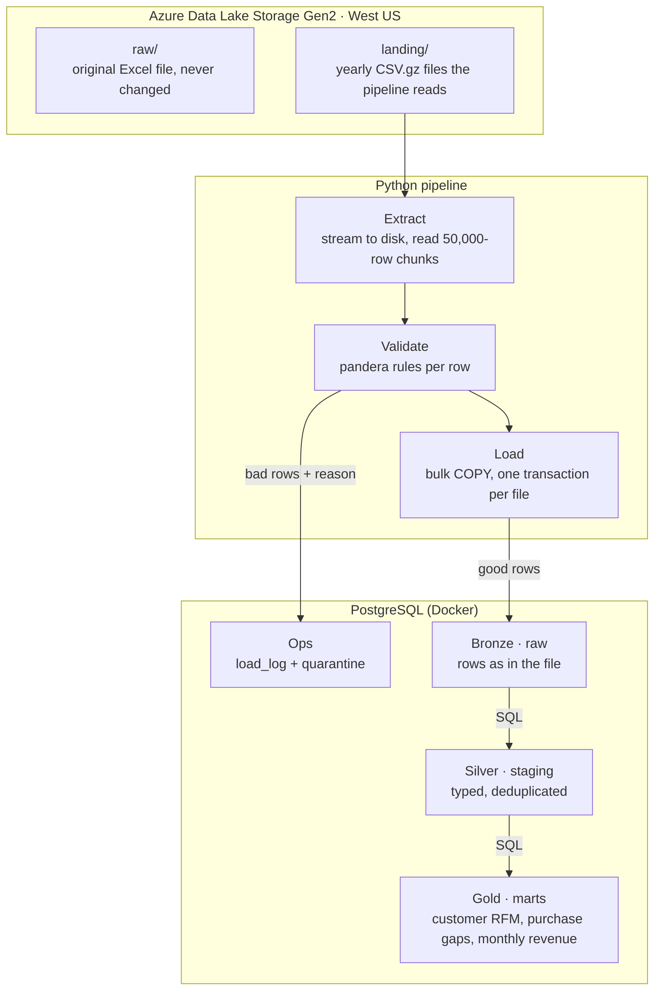
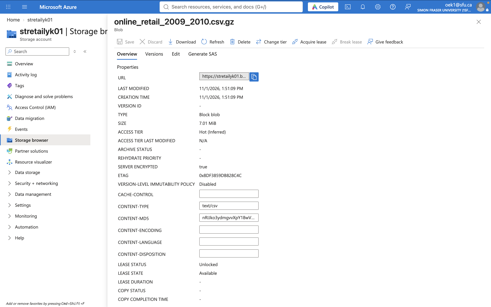

# Build Log

How TillFlow was built, phase by phase. Each phase was developed on its own branch, merged through a pull request, and verified before the next began.

← [Back to README](../README.md)

---
# TillFlow — Retail Data Pipeline (Azure Data Lake → PostgreSQL)

> **Status: in progress.** Project foundations are complete; the pipeline itself is being built in phases. See [Progress](#progress) for exactly what is done and what is next.

TillFlow is an end-to-end **ETL pipeline** that moves **1M+ real retail transactions** from an **Azure Data Lake** into **PostgreSQL**, validates every row, and turns the data into business-ready tables with SQL.

It is built the way a production data team would build it: reproducible environments, automated quality checks, secret scanning, login-based cloud access instead of stored keys, and a pull-request workflow for every change.

---

## Why this project

Most companies keep raw data in cloud storage that analysts can't use directly. Someone has to build a reliable pipeline that:

1. **Extracts** files from the data lake without running out of memory
2. **Validates** every row and sets bad rows aside _with a reason_, instead of silently dropping them
3. **Loads** clean data into a database safely, so re-running never creates duplicates
4. **Transforms** it into tables analysts can actually use (customer value, purchase habits, revenue trends)

TillFlow does all four on a real dataset and documents the engineering decisions behind each step.

---

## Architecture (target design)

The database layers follow the **medallion pattern**: `raw` = bronze, `staging` = silver, `marts` = gold.

---

## Progress

| Phase                 | What it covers                                                             | Status  |
| --------------------- | -------------------------------------------------------------------------- | ------- |
| 0 · Accounts & safety | Azure subscription, cost budget alert, Azure CLI login, dataset downloaded | Done    |
| 1 · Project scaffold  | Repo, Python packaging, dependency locking, pre-commit quality gates       | Done    |
| 2 · Azure Data Lake   | Resource group, ADLS Gen2 storage account, containers, role-based access   | Done    |
| 3 · Extract           | Chunked reads from the lake (real Azure or local emulator)                 | Done |
| 4 · Validate          | pandera schema, quarantine with reasons                                    | Done |
| 5 · Load              | Bulk `COPY` into Postgres, idempotent reruns, load log                     | Done |
| 6 · SQL transforms    | Silver + gold tables with CTEs and window functions                        | Done |
| 7 · Tests & CI        | GitHub Actions with Postgres + Azurite service containers                  | Done |
| 8 · Publish           | Measured results, screenshots, release v1.0.0                              | Planned |

### Phases

**Cloud setup**

- Azure subscription provisioned with a **budget alert** created before any resources, so spending is monitored from day one
- Azure CLI authenticated through **Microsoft Entra ID** (organizational login), so the pipeline will reach the data lake with the developer's identity instead of storing account keys

**Project foundations**

- Python 3.12 project managed with **uv**, with all dependencies pinned in a lockfile (`uv.lock`) for reproducible installs
- Installable package using the **`src/` layout** (`src/tillflow_retail_etl/`)
- Every change made on a **feature branch and merged through a pull request**

**Automated quality gates (pre-commit)**

Every commit is checked automatically before it is accepted:

| Hook                                     | What it protects against                                                                    |
| ---------------------------------------- | ------------------------------------------------------------------------------------------- |
| **Ruff** (lint + format)                 | Style issues, unused imports, common bug patterns                                           |
| **gitleaks**                             | Committing passwords, tokens or keys (verified by confirming it blocks a fake GitHub token) |
| **File-size guard** (1 MB limit)         | Accidentally committing the dataset or other large files                                    |
| **YAML / TOML checks, whitespace fixes** | Broken config files and messy diffs                                                         |

**Phase 2 · Azure Data Lake**

- Created an **Azure Data Lake Storage Gen2** account (`stretailyk01`) with hierarchical namespace enabled, public access blocked, HTTPS-only traffic and encryption at rest
- Set up two containers following a raw/landing pattern:
  - `raw/`: the original Excel file, never modified
  - `landing/`: pipeline-ready, gzip-compressed CSVs (one per year)
- Granted **least-privilege access**: the _Storage Blob Data Contributor_ role, scoped to this storage account only. All uploads and reads use **Microsoft Entra ID login**, with no account keys stored anywhere
- Converted the source Excel file to CSV once with [`scripts/convert_xlsx.py`](../scripts/convert_xlsx.py), keeping every value as text so nothing is altered before validation
- Verified the full dataset landed intact:

| File                             | Rows                                            |
| -------------------------------- | ----------------------------------------------- |
| `online_retail_2009_2010.csv.gz` | 525,461                                         |
| `online_retail_2010_2011.csv.gz` | 541,910                                         |
| **Total**                        | **1,067,371** (matches the UCI published count) |

This total is the pipeline's baseline: every later stage must account for all 1,067,371 rows as either loaded or quarantined.

- Confirmed **identity-based access from Python**: read the landing files directly from the lake using `DefaultAzureCredential`

_The 2009–2010 file in the `landing` container: 7 MB compressed, server-side encrypted, with an ETag the pipeline will use to detect changes._

**Phase 3 · Extract**

- Built [`extract.py`](../src/tillflow_retail_etl/extract.py): lists landing files with their **ETags** (fingerprints for safe reruns later), streams each one to disk, and reads it in **50,000-row chunks**, so memory never holds a whole file
- Runs against **real Azure or the local Azurite emulator** with one setting (`STORAGE_MODE`), so reviewers and tests need no cloud account
- Full extract from the Data Lake: **2 files, 22 chunks, 1,067,371 rows in about 2 seconds**, an exact match with the baseline
- Integration tests against Azurite check file listing and uneven chunk boundaries

**Phase 4 · Validate**

- **Profiled all 1,067,371 rows first** ([`scripts/profile_data.py`](../scripts/profile_data.py)) before writing any rules. Key findings:
  - 23% of rows have no customer ID (guest purchases): allowed
  - 34,335 exact duplicate rows: kept in bronze, to be removed in silver
  - Negative quantities on non-cancellation invoices (stock write-offs) and 5 negative-price "bad debt" adjustments: valid accounting events, classified later in SQL rather than rejected
  - Non-product stock codes (`POST`, `BANK CHARGES`, `AMAZONFEE`…) and inconsistent country names (`EIRE`, `RSA`): flagged for staging
- **Design principle:** validation rejects data that is *broken*; staging classifies data that is *valid but different*
- Built a [pandera](https://pandera.readthedocs.io/) schema in [`validate.py`](../src/tillflow_retail_etl/validate.py): invoice format, non-zero integer quantities, parseable dates, 5-digit customer IDs, and negative prices only on adjustment invoices
- Failing rows go to quarantine **with a reason per rule broken**, keeping their original values
- **Result on the full dataset:** 1,067,371 read = 1,067,371 valid + 0 quarantined, in 1.4 seconds
- 16 unit tests: valid-but-unusual rows pass, each broken-data rule fires, and rows in always equal rows valid + quarantined

**Phase 5 · Load**

- Created the database with idempotent SQL ([`sql/ddl/`](../sql/ddl/)): `raw` (bronze), `staging`, `marts` and `ops` schemas; `raw.transactions` keeps **lineage** (source file + load ID) on every row, and `NUMERIC` keeps prices exact
- Built [`load.py`](../src/tillflow_retail_etl/load.py) and [`pipeline.py`](../src/tillflow_retail_etl/pipeline.py), run with `make etl`:
  - **Bulk loads with Postgres `COPY`**, one 50,000-row chunk at a time
  - **One transaction per file**: a crash mid-file rolls back completely, with no partial loads
  - **Idempotent reruns**: an ETag-based load log skips files already loaded, and changed files are replaced, never duplicated
  - Every run (success, skipped or failed) is recorded in `ops.load_log`; rejected rows go to `ops.quarantine` with their original values and reason
- **Full load from Azure: 1,067,371 rows in ~20 seconds.** A rerun skips both files in 0.1 seconds with zero duplicates
- 4 integration tests against real Postgres prove skip-if-unchanged, replace-if-changed, **rollback on a mid-file crash**, and quarantine

**Phase 6 · SQL transforms**

- **Silver** ([`sql/staging/`](../sql/staging/)): removes **34,335 exact duplicates** with `ROW_NUMBER()`, standardizes country names, and **classifies** every row (cancellation, bad-debt adjustment, stock write-off, non-product, product sale) instead of deleting anything
- **Gold** ([`sql/marts/`](../sql/marts/)), built with CTE chains and window functions:
  - `customer_rfm`: recency, frequency and monetary scores (`NTILE`) for **5,852 customers**
  - `customer_purchase_gaps`: buying rhythm per customer via `LAG()` (average gap ≈ 112 days)
  - `monthly_revenue`: running totals and month-over-month change, with the final partial month flagged
- All transforms run in **one transaction**, so tables update together or not at all
- **Revenue reconciles to the cent** between silver and gold: **$19,642,676.02**
- 6 SQL tests on a hand-built dataset with hand-calculated answers; they run inside a rolled-back transaction, so real data is never touched

**Findings**
- Strong Q4 seasonality: revenue peaks every November (**$1.45M** in Nov 2011), with a post-holiday slump each January–February
- December 2011 looks like a 58% crash, but it contains only 9 days of data, which is why the mart flags partial months
- Guest purchases are **23% of rows but only 13% of revenue**: guests buy noticeably less per line than identified customers

**Phase 7 · CI with real services**

- GitHub Actions now starts **Postgres and Azurite with the same `docker-compose.yml` used locally**, so CI and development environments are identical
- Every pull request runs lint, format checks, and **all 29 tests** (unit + integration against real Postgres and the Azure storage emulator)
- An **end-to-end run** (`make seed etl transform`) loads the sample through bronze, silver and gold, then verifies row counts in each layer
- Because CI starts from a fresh clone on a clean machine, a green run also proves the project runs for anyone, with no Azure account needed
- `main` is protected: nothing merges unless CI passes
- One command for reviewers: `make all`
